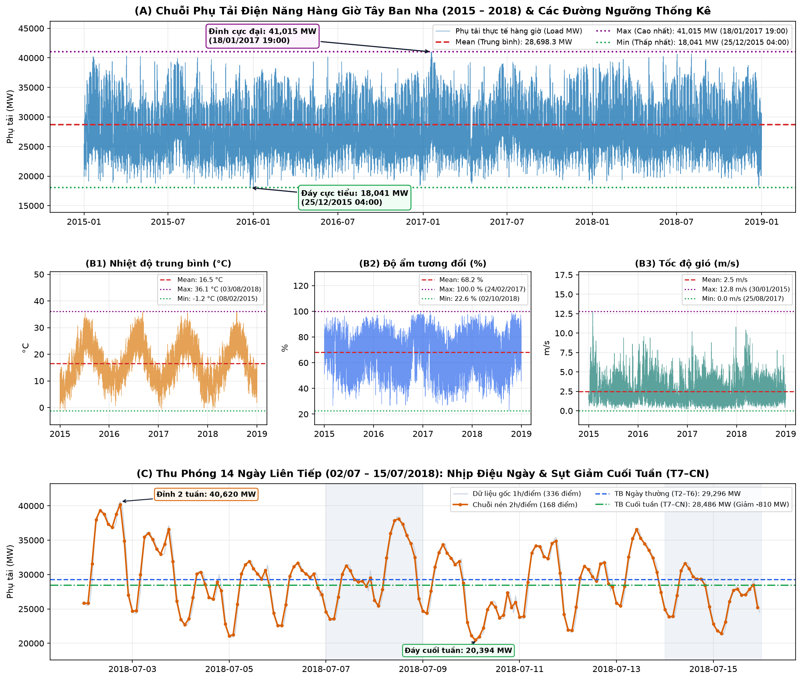
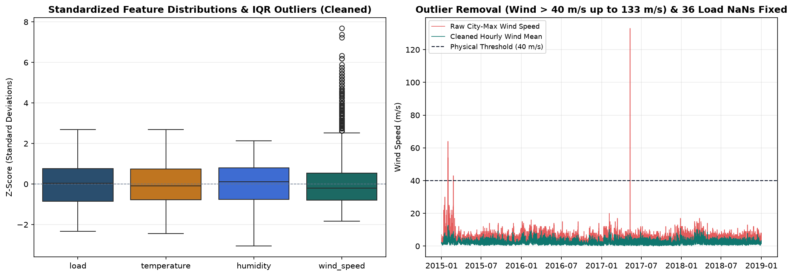
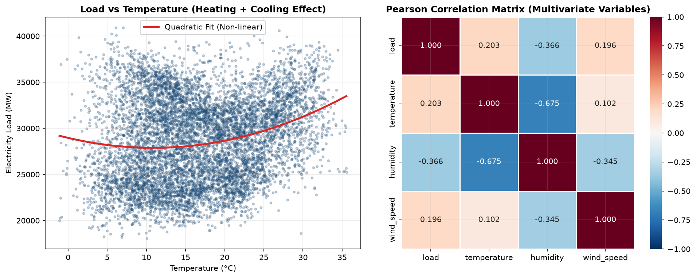
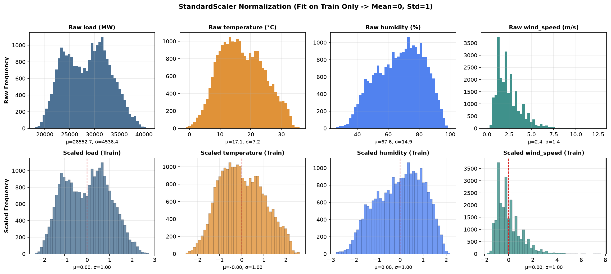

# 01. Khám Phá Dữ Liệu Đa Biến & Tiền Xử Lý (`Data Understanding & StandardScaler`)

Tài liệu này chi tiết hóa **Mục 1 – 4.1** trong [`practice 4.pdf`](../../practice%204.pdf), tương ứng với module [`scripts/data_loader.py`](../scripts/data_loader.py) và các cells EDA trong [`notebooks/main.ipynb`](../notebooks/main.ipynb).

---

## 1. Tập Dữ Liệu & Định Nghĩa Vector Quan Sát Đa Biến

* **Nguồn dữ liệu:** [Kaggle — Hourly Energy Demand Generation and Weather (Spain)](https://www.kaggle.com/datasets/nicholasjhana/energy-consumption-generation-prices-and-weather) gồm 2 file thô lưu tại `data/raw/`:
  - `energy_dataset.csv`: `35,064` giờ phụ tải điện năng quốc gia Tây Ban Nha (`total load actual`, đơn vị `MW`).
  - `weather_features.csv`: `178,396` bản ghi thời tiết hàng giờ của $5$ thành phố lớn (`Barcelona`, `Bilbao`, `Madrid`, `Seville`, `Valencia`).
* **Khoảng thời gian chuẩn hóa (UTC):** `2014-12-31 23:00:00+00:00` $\rightarrow$ `2018-12-31 22:00:00+00:00` (trọn $4$ năm liên tục, `35,064` giờ).
* **Vector quan sát đa biến tại thời điểm $t$:**
  $$X_t = [\text{load}_t,\ \text{temperature}_t,\ \text{humidity}_t,\ \text{wind\_speed}_t]$$
* **Mục tiêu dự báo:** Từ lịch sử cửa sổ $L = 24$ giờ gần nhất, dự báo phụ tải điện bước kế tiếp:
  $$X_{t-23:t} \Rightarrow \text{load}_{t+1}$$

---

## 2. Kiểm Tra Chất Lượng Dữ Liệu: Missing Values & Outliers

1. **Chuẩn hóa thời gian & Tổng hợp theo giờ:**
   - Ép kiểu mốc thời gian về chuẩn UTC và đồng bộ lưới tần suất `1 giờ` (`asfreq('h')`).
   - Quy đổi nhiệt độ từ Kelvin sang độ Celsius: $\text{temperature}\ (^\circ\text{C}) = \text{temp}\ (\text{K}) - 273.15$.
   - Tính trung bình khí tượng trên 5 thành phố theo từng giờ để tạo bảng chuẩn `35,064 × 4`.
2. **Xử lý Missing Values (`NaN`):**
   - Cột `load` ban đầu thiếu **`36` mốc giờ**; 3 biến thời tiết không có giá trị thiếu (`0 NaN`).
   - Sử dụng nội suy tuyến tính theo thời gian (`interpolate(method='time').bfill().ffill()`), đưa toàn bộ ma trận về **`0 NaN`**.
3. **Xử lý Outliers (Bất thường vật lý):**
   - Trong dữ liệu thô `weather_features.csv`, phát hiện **`4` bản ghi tốc độ gió phi vật lý `> 40 m/s`** (đỉnh điểm lên tới `133.0 m/s` $\approx 478\text{ km/h}$).
   - Các điểm lỗi này được gắn `NaN` trước khi gộp trung bình thành phố và nội suy lại, đưa dải giá trị hợp lý về `[0.00, 12.80] m/s`.

---

## 3. Thống Kê Mô Tả & Khám Phá Quan Hệ Phi Tuyến (`describe`)

| Biến quan sát | Đơn vị | Trung bình (Mean) | Độ lệch chuẩn (Std) | Min | Q25 (25%) | Trung vị (Median) | Q75 (75%) | Max |
|---|:---:|---:|---:|---:|---:|---:|---:|---:|
| **`load`** | MW | `28,698.28` | `4,575.83` | `18,041.00` | `24,807.00` | `28,902.00` | `32,194.25` | `41,015.00` |
| **`temperature`** | °C | `16.53` | `7.26` | `-1.21` | `10.91` | `15.88` | `21.94` | `36.12` |
| **`humidity`** | % | `68.22` | `14.89` | `22.60` | `56.80` | `69.80` | `80.20` | `100.00` |
| **`wind_speed`** | m/s | `2.47` | `1.35` | `0.00` | `1.40` | `2.20` | `3.20` | `12.80` |

### Phân tích Ma trận Tương quan (`Pearson` & `Spearman`)

| Biến so với `load` | Pearson ($r$) | Spearman ($\rho$) | Nhận xét kỹ thuật |
|---|:---:|:---:|---|
| **`temperature`** | `+0.2033` | `+0.1814` | Tương quan tuyến tính dương yếu, nhưng **đồ thị phân tán mang hình chữ U rõ nét**: phụ tải tăng cả khi trời rét (`< 10°C`, sưởi) và trời nóng (`> 25°C`, điều hòa). |
| **`humidity`** | **`-0.3661`** | **`-0.3690`** | Độ lớn tương quan tuyến tính mạnh nhất do độ ẩm nghịch pha với nhiệt độ ngày–đêm ($r(\text{temp}, \text{humidity}) = -0.6746$). |
| **`wind_speed`** | `+0.1965` | `+0.2238` | Biến đổi cùng pha với hoạt động ban ngày nhưng nhiễu ngắn hạn cao. |

---

## 4. Chuẩn Hóa Dữ Liệu Bằng `StandardScaler` (Mục 4.1)

Để `LSTM` hội tụ ổn định và tránh thiên lệch quy mô giữa biến `load` (hàng chục nghìn `MW`) và các biến thời tiết (độ C, %, m/s), toàn bộ 4 biến được chuẩn hóa Z-score:

$$z_t^{(v)} = \frac{x_t^{(v)} - \mu_{\text{train}}^{(v)}}{\sigma_{\text{train}}^{(v)}}$$

* **Nguyên tắc chống rò rỉ dữ liệu:** `StandardScaler` chỉ được `fit` trên tập **`Train` (`24,544` giờ)**, sau đó dùng cùng cặp $(\mu_{\text{train}}, \sigma_{\text{train}})$ để `transform` sang tập `Validation` và `Test`.
* **Quy đổi ngược khi đánh giá:** Tất cả chỉ số `RMSE`, `MAE`, `MAPE` ở bước đánh giá đều phải biến đổi ngược cột `load` qua $\hat{y}_{\text{MW}} = \hat{z} \cdot \sigma_{\text{train}}^{(\text{load})} + \mu_{\text{train}}^{(\text{load})}$ (lưu tại `models/standard_scaler.joblib`).

