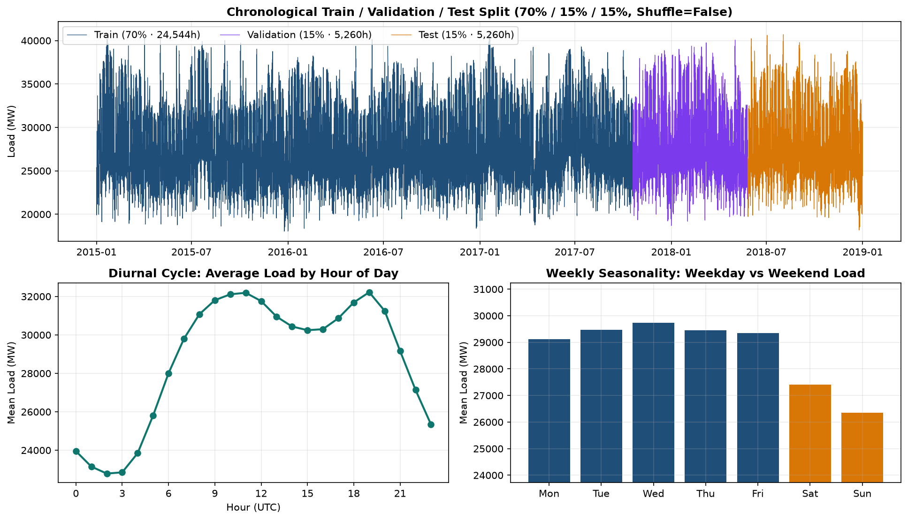
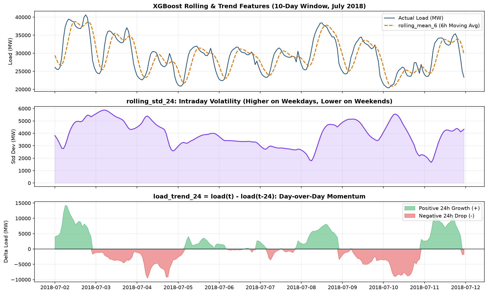

# 02. Chia Tập Theo Thời Gian & Tạo Đặc Trưng Đa Biến (`Temporal Split & Feature Engineering`)

Tài liệu này chi tiết hóa **Mục 4.2, Mục 5 & Mục 8.1** trong [`practice 4.pdf`](../../practice%204.pdf), tương ứng với module [`scripts/feature_engineering.py`](../scripts/feature_engineering.py).

---

## 1. Chia Tập Theo Thứ Tự Thời Gian (`70% / 15% / 15%`, `shuffle = False`)

Khác với dữ liệu bảng tĩnh, chuỗi thời gian đa biến bắt buộc chia tuần tự để mô phỏng đúng ngữ cảnh dự báo từ quá khứ sang tương lai:

| Tập dữ liệu | Tỷ lệ | Số giờ thô | Số mẫu cửa sổ ($L=24$) | Thời gian bắt đầu (UTC) | Thời gian kết thúc (UTC) | Phụ tải TB (MW) | Độ lệch chuẩn (MW) |
|---|:---:|---:|---:|---|---|---:|---:|
| **Train Set** | `70%` | `24,544` | `24,519` | `2014-12-31 23:00:00+00:00` | `2017-10-19 14:00:00+00:00` | `28,552.69` | `4,538.30` |
| **Validation Set** | `15%` | `5,260` | `5,260` | `2017-10-19 15:00:00+00:00` | `2018-05-26 18:00:00+00:00` | `29,051.26` | `4,705.27` |
| **Test Set** | `15%` | `5,260` | `5,260` | `2018-05-26 19:00:00+00:00` | `2018-12-31 22:00:00+00:00` | `29,024.66` | `4,590.51` |

* **Lưu ý ranh giới nối tiếp:** Tập Train mất `25` giờ đầu tiên làm lịch sử khởi tạo cho biến trễ `24h` và `load_trend_24`, còn toàn bộ **`5,260` giờ** của Validation và Test đều được giữ nguyên vì cửa sổ $24\text{h}$ của giờ đầu tiên được trích từ $24\text{h}$ cuối của tập liền trước (chỉ sử dụng thông tin $\le t$ để dự báo $t+1$).

---

## 2. Thiết Kế Cửa Sổ Trễ Đa Biến ($L = 24$ giờ)

Tại mỗi bước dự báo mục tiêu $y_t = \text{load}_{t+1}$:

1. **Ma trận đầu vào cho `XGBoost` (Dạng vector phẳng 2D — `99` đặc trưng):**
   - **96 biến trễ đa biến ($24 \text{ giờ} \times 4 \text{ biến}$):**
     $$[\text{load}_{t}, \dots, \text{load}_{t-23},\ \text{temp}_{t}, \dots, \text{temp}_{t-23},\ \text{humidity}_{t}, \dots, \text{humidity}_{t-23},\ \text{wind}_{t}, \dots, \text{wind}_{t-23}]$$
     *(Đặt tên tuần tự: `load_lag_1..24`, `temperature_lag_1..24`, `humidity_lag_1..24`, `wind_speed_lag_1..24` tương ứng với $t, t-1, \dots, t-23$).*
   - **3 biến Rolling & Trend (Mục 5.2 — chỉ dùng cho XGBoost):**
     - `rolling_mean_6`: Trung bình trượt 6 giờ gần nhất $\frac{1}{6}\sum_{i=0}^{5}\text{load}_{t-i}$
     - `rolling_std_24`: Độ lệch chuẩn 24 giờ gần nhất trên đoạn $[t-23, t]$
     - `load_trend_24`: Xu hướng phụ tải ngày $\text{load}_t - \text{load}_{t-24}$
   - **Bảng kích thước cuối cùng:** `X_xgb_train = (24519, 99)`, `X_xgb_val = (5260, 99)`, `X_xgb_test = (5260, 99)`.
   - Ngoài ra, tạo thêm tập **Ablation `Load-Only 27f`** (`24 load_lags + 3 rolling/trend`) để đo lường riêng đóng góp của 3 biến thời tiết.

2. **Tensor đầu vào cho `LSTM` (Dạng khối 3D — `(N, 24, 4)`):**
   - Mỗi mẫu là ma trận $24 \times 4$ giữ nguyên trình tự thời gian từ quá khứ đến hiện tại $[t-23 \rightarrow t]$ qua 4 kênh chuẩn hóa:
     `X_lstm_train = (24519, 24, 4)`, `X_lstm_val = (5260, 24, 4)`, `X_lstm_test = (5260, 24, 4)`.
   - Toàn bộ các cặp $(X_{\text{XGB}}, X_{\text{LSTM}}, X_{\text{VAR}})$ được căn chỉnh **1-đối-1 trên chính xác cùng tập chỉ số thời gian mục tiêu** để mọi phép so sánh định lượng hoàn toàn công bằng.

