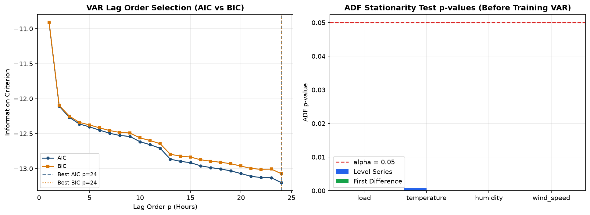
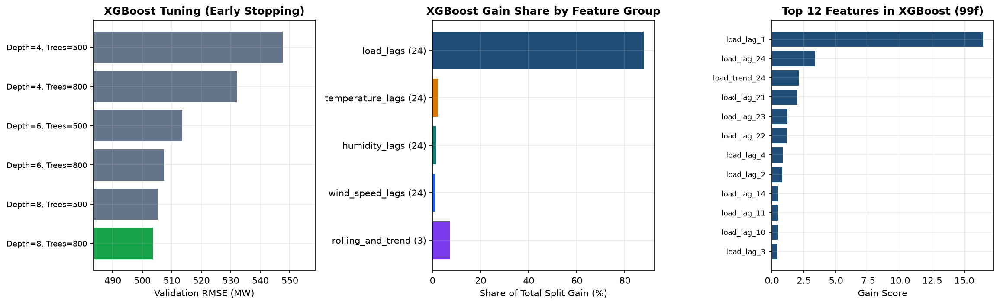
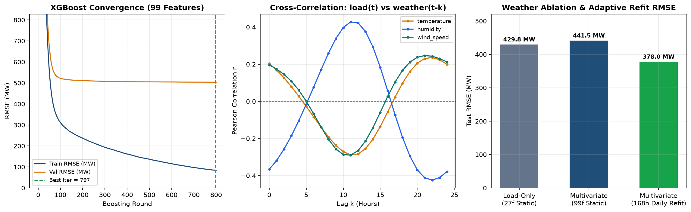

# 03. Mô Hình Hóa Với `VAR` (Thống Kê) & `XGBoost` (Machine Learning)

Tài liệu này chi tiết hóa **Mục 6 & Mục 7** trong [`practice 4.pdf`](../../practice%204.pdf), tương ứng với các lớp `VARForecaster` và `XGBoostMultivariateForecaster` trong [`scripts/models.py`](../scripts/models.py).

---

## 1. Mô Hình 1 — Vector Autoregression (`VAR` — Statistical Baseline)

### 1.1. Kiểm định tính dừng `ADF Test` & Chọn bậc trễ theo `AIC / BIC`
Mô hình hồi quy vector tự hồi quy bậc $p$ có dạng:
$$X_t = c + \sum_{i=1}^{p} A_i X_{t-i} + \varepsilon_t, \qquad X_t \in \mathbb{R}^{4}$$

| Biến (trên Train chuẩn hóa) | ADF Statistic (Level) | $p$-value (Level) | Dừng ở bậc gốc? | ADF $p$-value (Sai phân bậc 1) | Granger Causality lên `load` ($p$-value) |
|---|---:|---:|:---:|---:|---:|
| **`load`** | `-19.68` | `0.0000e+00` | ✅ Có | `0.0000e+00` | *(Biến phụ thuộc)* |
| **`temperature`** | `-4.15` | `8.1490e-04` | ✅ Có | `0.0000e+00` | **`6.7854e-69`** (Rất mạnh) |
| **`humidity`** | `-8.45` | `1.6816e-13` | ✅ Có | `0.0000e+00` | `2.2011e-05` |
| **`wind_speed`** | `-11.60` | `2.7200e-21` | ✅ Có | `0.0000e+00` | `3.3671e-06` |

* Vì cả 4 chuỗi đều dừng ở bậc gốc ($\alpha = 0.05 \rightarrow d = 0$), mô hình được huấn luyện trực tiếp trên chuỗi đã chuẩn hóa.
* Cả tiêu chuẩn **AIC** và **BIC** đều hội tụ chọn bậc trễ **$p = 24$ giờ** (tổng cộng `97` tham số cho mỗi phương trình $\times\ 4$ phương trình = **`388` tham số**).

### 1.2. Kết quả dự báo riêng cột `load` (đã `inverse_transform` về MW)
* **Train Set:** `RMSE = 765.88 MW` | `MAE = 507.54 MW` | `MAPE = 1.82%` | $R^2 = 0.9715$
* **Validation Set:** `RMSE = 793.68 MW` | `MAE = 516.96 MW` | `MAPE = 1.82%` | $R^2 = 0.9716$
* **Test Set:** **`RMSE = 686.27 MW`** | **`MAE = 482.72 MW`** | **`MAPE = 1.71%`** | $R^2 = 0.9777$ (thời gian fit: `9.19s`).

---

## 2. Mô Hình 2 — `XGBoost` Đa Biến & Ablation Thời Tiết (Machine Learning)

### 2.1. Tuning siêu tham số với Early Stopping (`early_stopping_rounds = 40`)
| Cấu hình thử nghiệm | Số cây tối ưu (`Best Iter`) | Validation RMSE (MW) | Validation MAE (MW) |
|---|:---:|---:|---:|
| `max_depth=4, n_estimators=500` | `500` | `547.60` | `350.36` |
| `max_depth=4, n_estimators=800` | `800` | `532.12` | `336.93` |
| `max_depth=6, n_estimators=500` | `488` | `513.60` | `309.94` |
| `max_depth=6, n_estimators=800` | `800` | `507.39` | `303.82` |
| `max_depth=8, n_estimators=500` | `491` | `505.14` | `292.05` |
| **`max_depth=8, n_estimators=800` (Selected)** | **`797`** | **`503.56`** | **`290.65`** |

### 2.2. Hiệu năng trên Test Set & Phân tích Feature Importance
* **`XGBoost (Multivariate 99f)`:** `Train RMSE = 84.20 MW`, `Val RMSE = 503.56 MW`, **`Test RMSE = 441.47 MW`**, **`Test MAE = 279.88 MW`**, **`MAPE = 0.97%`**, $R^2 = 0.9908$ (giảm **`35.67%` RMSE** so với `VAR`).
* **`XGBoost (Load-Only 27f)` (Ablation):** `Train RMSE = 233.29 MW`, `Val RMSE = 484.82 MW`, **`Test RMSE = 429.79 MW`**, **`Test MAE = 274.18 MW`**, **`MAPE = 0.96%`**, $R^2 = 0.9912$.
  * *Nhận xét:* Khi đưa toàn bộ 72 biến trễ thời tiết thô (`lag 1..24` của 3 biến), độ sâu `8` dễ quá khớp hơn vào nhiễu tập Train (`Overfit Gap` tăng từ `+196.51 MW` lên `+357.27 MW`), trong khi bộ 24 lags nội tại + 3 rolling/trend của `load` đã gián tiếp chứa sẵn quán tính thời tiết trước đó.
* **Tỷ trọng Gain theo nhóm biến (`XGBoost 99f`):**
  - `load_lags (24)`: **`87.83%`** (đứng đầu: `load_lag_1=16.5`, `load_lag_24=3.4`, `load_lag_21=2.0`)
  - `rolling_and_trend (3)`: **`7.39%`** (`load_trend_24=2.1`)
  - `temperature_lags (24)`: **`2.27%`** (mạnh nhất trong nhóm thời tiết)
  - `humidity_lags (24)`: **`1.44%`**
  - `wind_speed_lags (24)`: **`1.07%`**

