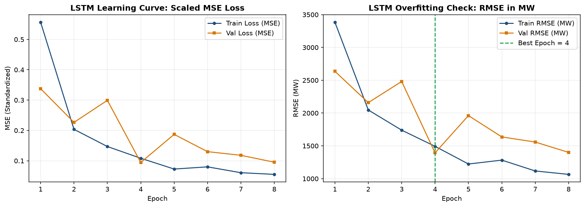
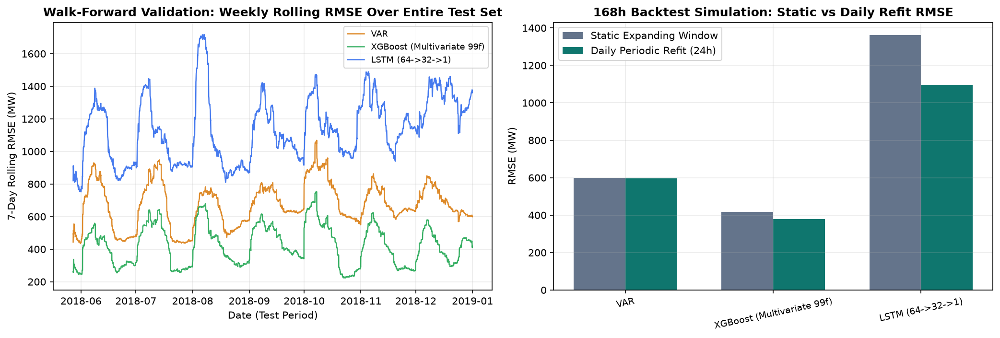
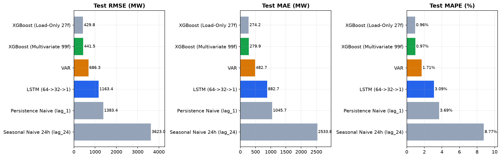
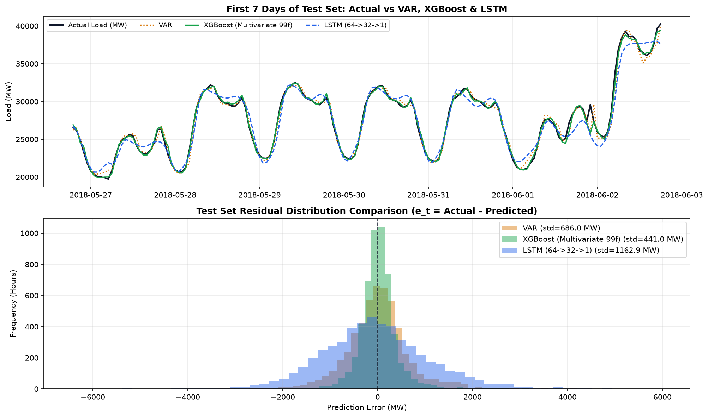
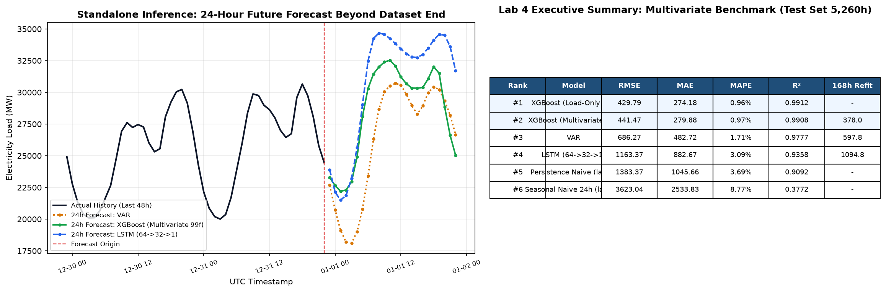

# 04. Mô Hình `LSTM` (Deep Learning), `Walk-Forward Validation` & Đánh Giá Tổng Hợp

Tài liệu này chi tiết hóa **Mục 8, Mục 9 & Mục 10** trong [`practice 4.pdf`](../../practice%204.pdf), tương ứng với lớp `LSTMForecaster`, hàm `run_walk_forward_backtest` trong [`scripts/models.py`](../scripts/models.py) và pipeline suy luận [`scripts/predict.py`](../scripts/predict.py).

---

## 1. Mô Hình 3 — Stacked `LSTM` (Deep Learning, Mục 8)

* **Kiến trúc mạng theo đúng đặc tả đề bài:**
  ```text
  Input(shape=(24, 4)) -> LSTM(64, return_sequences=True) -> LSTM(32) -> Dense(1)
  ```
* **Cấu hình huấn luyện:** Loss = `MSE`, Optimizer = `Adam (lr=1e-3)`, `batch_size = 256`, `epochs = 20`, `EarlyStopping(monitor='val_loss', patience=4, restore_best_weights=True)`.
* **Quá trình hội tụ:** Dừng sớm sau **`8` epochs** (`18.86s` trên CPU), `Final Train RMSE = 1,065.37 MW` (tại epoch 8) và trọng số tốt nhất đạt:
  - `Train Set`: `RMSE = 1,257.04 MW` | `MAE = 958.94 MW` | `MAPE = 3.44%` | $R^2 = 0.9232$
  - `Validation Set`: `RMSE = 1,393.63 MW` | `MAE = 1,054.81 MW` | `MAPE = 3.75%` | $R^2 = 0.9123$
  - `Test Set`: **`RMSE = 1,163.37 MW`** | **`MAE = 882.67 MW`** | **`MAPE = 3.09%`** | $R^2 = 0.9358$ (tốt hơn `Persistence Naive` `1,383.37 MW` và `Seasonal Naive` `3,623.04 MW`).



---

## 2. Walk-Forward Validation / Backtesting (Mục 9)

Để mô phỏng sát quá trình vận hành thực tế (`Train -> predict t+1 -> cập nhật quan sát mới vào chuỗi -> predict t+2 -> ...`), dự án triển khai đồng thời 2 lớp kiểm định trên toàn bộ 3 nhóm mô hình:

1. **Expanding-Window Walk-Forward (Toàn bộ `5,260` giờ Test):** Tại mỗi giờ $t$, mô hình nhận trực tiếp vector thực tế $X_{t-23:t}$ vừa thu thập để dự báo $\hat{y}_{t+1}$ (không dùng dữ liệu tương lai).
2. **Adaptive Daily-Refit Walk-Forward (`168` giờ cuối của Test Set):** Mô hình được tái huấn luyện / tinh chỉnh định kỳ sau mỗi `24` giờ (`refit_every = 24`) khi tích lũy thêm dữ liệu ngày vừa qua:

| Mô hình | Static 168h Walk-Forward RMSE (MW) | Daily-Refit 168h Walk-Forward RMSE (MW) | Mức cải thiện nhờ Daily Refit |
|---|---:|---:|---:|
| **`XGBoost (Multivariate 99f)`** | `418.38` | **`377.98`** | **$-40.40\text{ MW}$ ($-9.66\%$)** |
| **`VAR` ($p=24$)** | `598.76` | `597.81` | $-0.95\text{ MW}$ ($-0.16\%$) |
| **`LSTM (64->32->1)`** | `1,362.21` | **`1,094.81`** | **$-267.40\text{ MW}$ ($-19.63\%$)** |

* **Ý nghĩa thực tiễn:** Khi chuỗi bước sang giai đoạn cuối năm (`Tháng 12`), phân phối phụ tải và thời tiết dịch chuyển theo mùa khiến bộ trọng số tĩnh cũ kém dần đi; việc cập nhật hàng ngày giúp cả `XGBoost` lẫn `LSTM` thích nghi tức thời và giảm mạnh sai số dự báo.



---

## 3. Bảng Xếp Hạng Tổng Hợp & Dự Báo Độc Lập 24 Giờ Tới (Mục 10)

| Rank | Mô hình | Test RMSE (MW) | Test MAE (MW) | Test MAPE (%) | $R^2$ | Mean Bias (MW) | Ljung-Box $p$-val | Train Time |
|:---:|---|---:|---:|---:|---:|---:|---:|---:|
| **#1** | `XGBoost (Load-Only 27f)` | **`429.79`** | **`274.18`** | **`0.96%`** | `0.9912` | `+15.60` | `1.46e-36` | `3.34s` |
| **#2** | `XGBoost (Multivariate 99f)` | **`441.47`** | **`279.88`** | **`0.97%`** | `0.9908` | `+19.64` | `1.05e-49` | `11.36s` |
| **#3** | `VAR` | `686.27` | `482.72` | `1.71%` | `0.9777` | `+19.95` | `7.95e-125` | `9.19s` |
| **#4** | `LSTM (64->32->1)` | `1,163.37` | `882.67` | `3.09%` | `0.9358` | `-31.97` | `0.00e+00` | `18.86s` |
| **#5** | `Persistence Naive (lag_1)` | `1,383.37` | `1,045.66` | `3.69%` | `0.9092` | `-0.24` | `0.00e+00` | `0.00s` |
| **#6** | `Seasonal Naive 24h (lag_24)` | `3,623.04` | `2,533.83` | `8.77%` | `0.3772` | `+1.69` | `0.00e+00` | `0.00s` |

### Kết quả chạy suy luận độc lập ([`scripts/predict.py`](../scripts/predict.py) — Dự báo 24h sau `2018-12-31 22:00 UTC`)
* **`XGBoost (Multivariate 99f)`:** Trung bình `28,550.8 MW` (`22,194.7` $\rightarrow$ `32,528.7 MW`).
* **`LSTM (64->32->1)`:** Trung bình `30,765.9 MW` (`21,502.9` $\rightarrow$ `34,678.8 MW`).
* **`VAR`:** Trung bình `26,237.9 MW` (`18,121.4` $\rightarrow$ `30,709.5 MW`).




