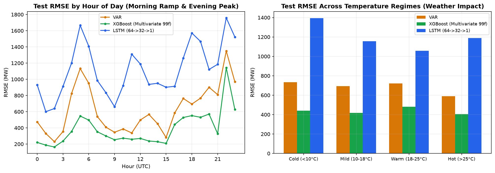
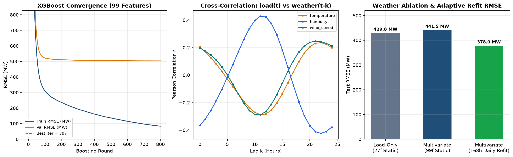
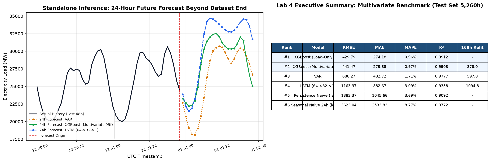

# 05. Giải Đáp 6 Câu Hỏi Phân Tích & Bài Tập Nâng Cao Traffic Forecasting

Tài liệu này chi tiết hóa **Mục 11 & Mục 12** trong [`practice 4.pdf`](../../practice%204.pdf), dựa trên kết quả thực nghiệm của [`notebooks/main.ipynb`](../notebooks/main.ipynb) và [`scripts/train.py`](../scripts/train.py).

---

## 1. Giải Đáp Chi Tiết 6 Câu Hỏi Phân Tích (Mục 11)

### Câu 1: Biến thời tiết nào ảnh hưởng mạnh nhất đến điện năng?
* **Theo tương quan tuyến tính & thứ hạng:** **`humidity`** đạt độ lớn tương quan cao nhất với phụ tải điện (Pearson $r = -0.3661$, Spearman $\rho = -0.3690$) do độ ẩm dao động ngược chiều với nhiệt độ và phụ tải sản xuất–sinh hoạt ban ngày.
* **Theo quan hệ nhân quả & độ lợi mô hình:** **`temperature`** là biến có tác động thực chất mạnh nhất:
  - Kiểm định nhân quả Granger từ thời tiết lên `load` trong mô hình `VAR`: `temperature` đạt **$p = 6.79 \times 10^{-69}$** (vượt xa `wind_speed` $p = 3.37 \times 10^{-6}$ và `humidity` $p = 2.20 \times 10^{-5}$).
  - Trong `XGBoost (Multivariate 99f)`, nhóm `temperature_lags` chiếm **`2.27%` tổng Gain** — cao hơn `humidity_lags` (`1.44%`) và `wind_speed_lags` (`1.07%`).

### Câu 2: Khi nào `VAR` thất bại?
`VAR` có `Test RMSE = 686.27 MW`, cao hơn `XGBoost` tới **`+244.80 MW`**, thất bại rõ nhất trong 3 tình huống:
1. **Quan hệ phi tuyến chữ U (`Load` vs `Temperature`):** Cả khi trời lạnh (`< 10°C`) và nóng (`> 25°C`), điện năng đều tăng vọt; mô hình tuyến tính $A_i X_{t-i}$ chỉ học được một hệ số góc cố định nên sinh sai số lớn ở các vùng nhiệt độ cực trị (`Cold <10°C`: VAR RMSE `734.69 MW` vs XGBoost `441.50 MW`).
2. **Đa chu kỳ lồng nhau & Bùng nổ tham số:** Với 4 biến và độ trễ $p=24$, VAR phải ước lượng đồng thời `388` tham số tự do, dễ bị nhiễu cộng tuyến ở những khung giờ chuyển tải buổi sáng.
3. **Chuỗi không dừng hoặc biến ngoại sinh đột biến:** Nếu chuỗi có xu hướng dài hạn chưa sai phân hoặc sốc thời tiết cục bộ, hệ phương trình tuyến tính phản ứng chậm.

### Câu 3: `XGBoost` học được thông tin gì từ thời tiết?
Bảng sai số `Test RMSE (MW)` theo từng chế độ nhiệt độ chứng minh khả năng rẽ nhánh phi tuyến của cây quyết định:

| Chế độ nhiệt độ | `XGBoost (99f)` RMSE (MW) | `VAR` RMSE (MW) | `LSTM` RMSE (MW) |
|---|---:|---:|---:|
| **Lạnh (`< 10°C`)** | **`441.50`** | `734.69` | `1,393.65` |
| **Mát (`10 – 18°C`)** | **`416.73`** | `694.20` | `1,156.04` |
| **Ấm (`18 – 25°C`)** | **`481.66`** | `720.02` | `1,057.11` |
| **Nóng (`> 25°C`)** | **`405.26`** | `588.88` | `1,189.32` |

* Ngoài ra, thực nghiệm Ablation (`14_xgboost_learning_curves_and_weather_ablation.png`) chỉ ra bài học quan trọng trong thiết kế đặc trưng: khi đã có đủ `24` lags nội tại + `rolling/trend` của `load`, việc nhồi thêm toàn bộ `72` lags thời tiết (`lag 1..24`) làm độ sâu cây dễ học khớp nhiễu tập Train (`Overfit Gap` tăng từ `+196.51 MW` lên `+357.27 MW`). Trong thực tế, chỉ cần giữ `temperature_lag_1` hoặc dự báo nhiệt độ giờ tới thay vì đưa tràn lan `24` lags của mọi biến thời tiết.

### Câu 4: `LSTM` học được chu kỳ nào (ngày, tuần)?
* Với đầu vào Tensor 3D kích thước **`(24, 4)`** (cửa sổ `L = 24` giờ), LSTM nhìn thấy trọn vẹn **chu kỳ ngày (`24h`)**, nhưng **không thể nhìn trực tiếp được chu kỳ tuần (`168h`)** bên trong một mẫu đơn lẻ. Để học tốt hơn ở bài toán phụ tải điện, cần kéo dài cửa sổ lên `168` bước hoặc bổ sung đặc trưng lịch (`dayofweek`, `is_weekend`).

### Câu 5: `LSTM` có bị overfitting không?
* **Không bị overfitting:** `Train RMSE = 1,257.04 MW`, `Val RMSE = 1,393.63 MW`, `Test RMSE = 1,163.37 MW` (`Overfit Gap = -93.67 MW`).
* Ngược lại, với `EarlyStopping(patience=4)` dừng ở epoch `8` và `batch_size = 256` trên `24,519` mẫu, LSTM đang ở trạng thái **hơi underfitting** so với cấu trúc chi tiết từng giờ mà `XGBoost` nắm bắt được qua cây phân hoạch + biến `load_trend_24`.

### Câu 6: Sự khác biệt giữa Machine Learning (`XGBoost`) và Deep Learning (`LSTM`) trong bài toán này?
* **`XGBoost` (ML trên dữ liệu bảng 2D):** Mạnh vượt trội trên dữ liệu dạng bảng kích thước vừa (`~24k–35k` giờ), học ngưỡng phi tuyến nhanh (`11.36s`), đạt độ chính xác cao nhất (`RMSE = 441.47 MW`, `MAPE = 0.97%`), giải thích trực quan qua Gain Importance; nhưng phụ thuộc mạnh vào feature engineering thủ công (`rolling_mean_6`, `load_trend_24`).
* **`LSTM` (DL trên chuỗi 3D):** Học trực tiếp biểu diễn tuần tự mà không cần tự thiết kế rolling/trend, nhưng đòi hỏi nhiều dữ liệu/epochs hơn để vượt qua cây quyết định trên chuỗi 1 giờ và rất nhạy cảm với cập nhật phân phối theo mùa (minh họa rõ khi `Daily Refit` giảm RMSE của LSTM tới `267.4 MW`).

---

## 2. Bài Tập Nâng Cao: Traffic Forecasting (`METR-LA` & `PEMS-BAY`, Mục 12)

### 2.1. Định nghĩa bài toán Không gian – Thời gian (*Spatio-Temporal Forecasting*)
* **Bộ dữ liệu chuẩn benchmark:** `METR-LA` (207 cảm biến vòng từ trên cao tốc Los Angeles) hoặc `PEMS-BAY` (Bay Area, California), lấy mẫu mỗi `5 phút`.
* **Vector trạng thái $207$ chiều tại mỗi mốc 5 phút:**
  $$X_t = [\text{speed}_1,\ \text{speed}_2,\ \dots,\ \text{speed}_{207}] \in \mathbb{R}^{207}$$
* **Bài toán dự báo đa bước ($15$, $30$, $60$ phút phía trước):**
  $$[X_{t-12},\ \dots,\ X_t] \Rightarrow [X_{t+3},\ X_{t+6},\ X_{t+12}]$$

### 2.2. Tại sao cần chuyển từ `VAR/XGBoost/LSTM` sang `DCRNN`?
1. **`VAR` bùng nổ chiều:** Với $N = 207$ trạm và $p = 12$ bước, số tham số là $207^2 \times 12 \approx 514,000$ hệ số — suy biến hoàn toàn trên thực tế.
2. **`XGBoost` & `LSTM` chuẩn bỏ qua cấu trúc đồ thị đường bộ:** Hai cảm biến liền kề trên cùng tuyến cao tốc (thượng nguồn & hạ nguồn) liên hệ theo khoảng cách mạng lưới đường chứ không theo thứ tự chỉ số mảng; việc dự báo độc lập `207 × 3 = 621` mô hình sẽ mất toàn bộ thông tin lan truyền kẹt xe.
3. **Kiến trúc chuẩn DCRNN (*Diffusion Convolutional Recurrent Neural Network*):**
   - Biểu diễn hệ thống giao thông thành đồ thị có hướng $G = (V, E, W)$ với ma trận trọng số khoảng cách đường bộ $W_{ij} = \exp(-\text{dist}(v_i, v_j)^2 / \sigma^2)$.
   - Thay thế phép nhân ma trận tuyến tính trong cell hồi quy `GRU` bằng toán tử **Diffusion Convolution** hai chiều (nắm bắt dòng xe đi xuôi dòng $P = D_O^{-1}W$ và hiệu ứng ùn tắc lan ngược dòng $P^T = D_I^{-1}W^T$).
   - Sử dụng cấu trúc **Encoder–Decoder Seq2Seq** kết hợp **Scheduled Sampling** để dự báo đồng bộ toàn bộ 207 nút tại cả 3 mốc `15p`, `30p`, `60p` với độ chính xác vượt trội mọi mô hình đơn biến hoặc đa biến phẳng.

