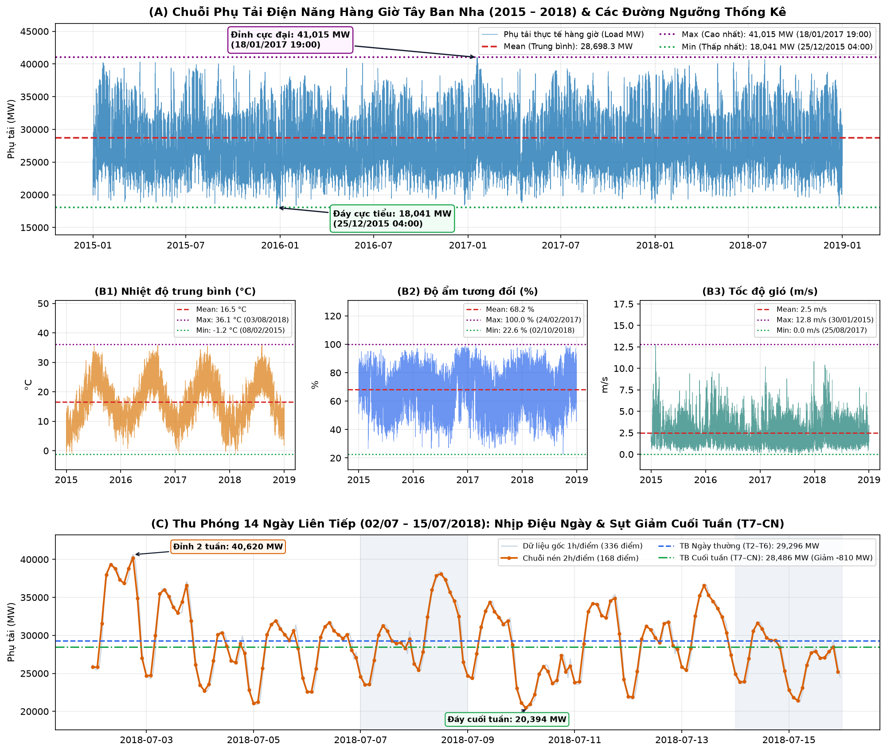
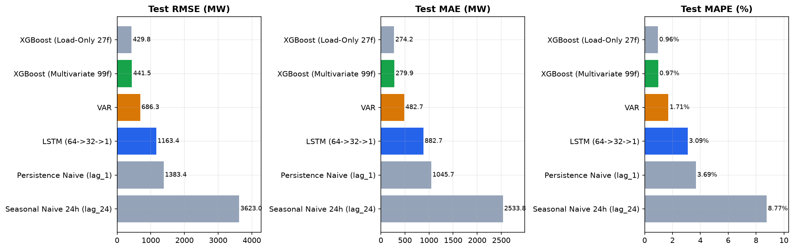
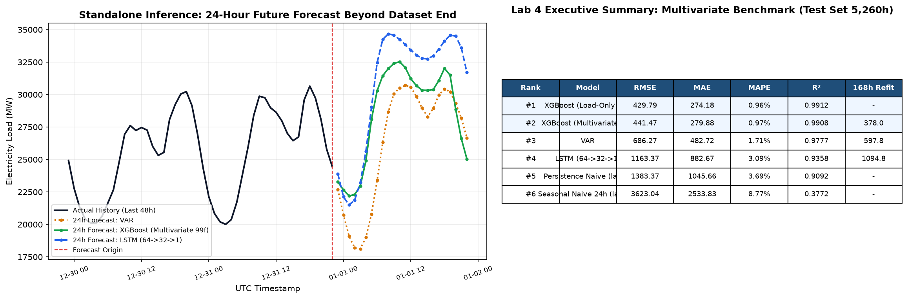

<div align="center">

# Lab 4: Dự Báo Chuỗi Thời Gian Đa Biến (Multivariate Time Series Forecasting)
### Electricity Load + Weather · Feature Engineering, Chuẩn Hóa `StandardScaler`, Huấn Luyện `VAR` / `XGBoost` / `LSTM` & Walk-forward Validation

<p>
  
  
  
  
  
</p>

| Thuộc tính | Chi tiết |
|---|---|
| **Đề bài tham chiếu** | [`practice 4.pdf`](../../practice%204.pdf) (*Multivariate Time Series Forecasting: Electricity Load + Weather*) |
| **Notebook chính** | [`notebooks/main.ipynb`](../notebooks/main.ipynb) (`18` cells — đã chạy hoàn tất `0` lỗi) |
| **Dữ liệu chính (Dataset)** | **Kaggle Hourly Energy Demand & Weather (Spain)** (`35,064` giờ `2015–2018`, $X_t = [load_t,\ temp_t,\ humidity_t,\ wind\_speed_t]$) |
| **Mục tiêu dự báo** | Cửa sổ lịch sử $L = 24$ giờ gần nhất dự báo phụ tải bước kế tiếp: $X_{t-23:t} \Rightarrow load_{t+1}$ |
| **Mô hình cốt lõi** | `VAR(p=24)`, `XGBoost Regressor` (`99` features & `27` features), `LSTM(64)->LSTM(32)->Dense(1)` |
| **Kỹ thuật thẩm định** | Time-based Split ($70\% / 15\% / 15\%$, `shuffle = False`), **Walk-forward Validation (Backtesting)** |
| **Độ đo đánh giá** | RMSE (`MW`), MAE (`MW`), MAPE (`%`), $R^2$ Score |

</div>

---

## 1. Giới Thiệu Dự Án

Dự án này triển khai trọn vẹn bài thực hành **dự báo chuỗi thời gian đa biến (Multivariate Time Series Forecasting)** kết hợp phụ tải điện năng quốc gia Tây Ban Nha và dữ liệu thời tiết trung bình từ $5$ thành phố lớn (`Madrid`, `Barcelona`, `Valencia`, `Seville`, `Bilbao`).

Kết quả thực nghiệm nổi bật trên tập Kiểm thử độc lập (`5,260` giờ cuối, `05/2018 – 12/2018`):
* **`XGBoost (Load-Only 27f)`:** `Test RMSE = 429.79 MW`, `MAE = 274.18 MW`, `MAPE = 0.96%`, $R^2 = 0.9912$.
* **`XGBoost (Multivariate 99f)`:** `Test RMSE = 441.47 MW`, `MAE = 279.88 MW`, `MAPE = 0.97%`, $R^2 = 0.9908$ (giảm `35.67%` RMSE so với `VAR`).
* **`VAR` ($p=24$, $d=0$):** `Test RMSE = 686.27 MW`, `MAE = 482.72 MW`, `MAPE = 1.71%`, $R^2 = 0.9777$.
* **`LSTM` (`64->32->1`):** `Test RMSE = 1,163.37 MW`, `MAE = 882.67 MW`, `MAPE = 3.09%`, $R^2 = 0.9358$ (cải thiện xuống `1,094.81 MW` trên khung 168h khi bật cập nhật định kỳ `Daily Refit`).

---

## 2. Cấu Trúc Thư Mục

```text
Lab4_TS/
├── .gitignore
├── requirements.txt
├── data/
│   ├── raw/                   # energy_dataset.csv & weather_features.csv (Kaggle Spain)
│   └── processed/             # electricity_weather_clean.csv, train_scaled.csv, val_scaled.csv, test_scaled.csv
├── notebooks/
│   └── main.ipynb             # Jupyter Notebook hoàn chỉnh 12 mục (18 cells đã thực thi)
├── scripts/
│   ├── __init__.py
│   ├── config.py              # Cấu hình đường dẫn, hyperparameters VAR / XGBoost / LSTM
│   ├── data_loader.py         # Ghép bảng điện + thời tiết, xử lý 36 NaN & 4 wind outliers (>40 m/s)
│   ├── feature_engineering.py # Chia 70/15/15, StandardScaler, tạo cửa sổ 2D (99f) & Tensor 3D (24x4)
│   ├── evaluation.py          # Tính RMSE, MAE, MAPE, R2 & Ljung-Box test
│   ├── visualization.py       # Tự động xuất 10 biểu đồ phân tích
│   ├── models.py              # VARForecaster, XGBoostMultivariateForecaster, LSTMForecaster & Backtest
│   ├── train.py               # Pipeline CLI huấn luyện, tuning, backtest & lưu toàn bộ artifacts
│   └── predict.py             # Pipeline suy luận độc lập từ model đã lưu & dự báo 24h tới
├── models/
│   ├── standard_scaler.joblib
│   ├── var_model.joblib
│   ├── xgboost_load_only.joblib
│   ├── xgboost_multivariate.joblib
│   ├── lstm_multivariate.keras
│   └── model_registry.json
├── logs/
│   ├── pipeline_training.log
│   ├── model_comparison_summary.txt
│   ├── metrics_leaderboard.csv
│   ├── experiments_history.json
│   ├── inference.log
│   └── latest_predictions.csv
└── docs/
    ├── README.md                                          # Trang chủ tài liệu & chỉ mục dự án Lab 4
    ├── 01_data_understanding_and_preprocessing.md         # Phần 1: EDA, Missing/Outliers & StandardScaler
    ├── 02_temporal_split_and_feature_engineering.md       # Phần 2: Chia tập 70/15/15, Lags 24h, Rolling & Tensor 3D
    ├── 03_var_and_xgboost_modeling.md                     # Phần 3: VAR (ADF, AIC/BIC) & XGBoost (Tuning + Ablation)
    ├── 04_lstm_and_walk_forward_backtesting.md            # Phần 4: LSTM (64->32->1), Walk-Forward Validation & Inference
    ├── 05_analytical_questions_and_traffic_forecasting.md # Phần 5: 6 Câu hỏi phân tích & Bài tập nâng cao METR-LA/DCRNN
    ├── report.md                                          # Báo cáo tổng hợp kết quả toàn dự án Lab 4
    └── images/                                            # 15 biểu đồ trực quan hóa đầy đủ (01_.. -> 15_..)
```

---

## 3. Danh Mục Tài Liệu Kỹ Thuật (Đã Hoàn Thành 100%)

* 📘 **[01. Khám Phá Dữ Liệu Đa Biến & Tiền Xử Lý (`01_data_understanding_and_preprocessing.md`)](01_data_understanding_and_preprocessing.md)**  
  Ghép dữ liệu điện Tây Ban Nha + thời tiết 5 thành phố (`35,064` giờ), xử lý `36` giá trị thiếu, lọc `4` outlier gió `> 40 m/s`, ma trận tương quan & chuẩn hóa `StandardScaler`.

* 🗂️ **[02. Chia Tập Theo Thời Gian & Tạo Đặc Trưng (`02_temporal_split_and_feature_engineering.md`)](02_temporal_split_and_feature_engineering.md)**  
  Chia tuần tự `70% / 15% / 15%`, thiết kế ma trận `99` cột (`24 × 4 lags` + `rolling_mean_6`, `rolling_std_24`, `load_trend_24`) và Tensor 3D `(24, 4)`.

* 📊 **[03. Mô Hình Thống Kê VAR & Học Máy XGBoost (`03_var_and_xgboost_modeling.md`)](03_var_and_xgboost_modeling.md)**  
  Kiểm định dừng `ADF`, bậc trễ `p = 24` (`AIC/BIC`), nhân quả Granger (`temperature` $p = 6.79 \times 10^{-69}$), tuning lưới `XGBoost` & thực nghiệm Ablation thời tiết.

* ⚙️ **[04. Mô Hình LSTM, Walk-Forward Backtest & Bảng Xếp Hạng (`04_lstm_and_walk_forward_backtesting.md`)](04_lstm_and_walk_forward_backtesting.md)**  
  Huấn luyện `LSTM(64)->LSTM(32)->Dense(1)`, mô phỏng **Walk-Forward Daily Refit** (`XGBoost` đạt `377.98 MW`), bảng tổng kết 6 mô hình & dự báo `24h` tới.

* 📈 **[05. 6 Câu Hỏi Phân Tích & Bài Tập Nâng Cao Traffic Forecasting (`05_analytical_questions_and_traffic_forecasting.md`)](05_analytical_questions_and_traffic_forecasting.md)**  
  Giải đáp định lượng $6$ câu hỏi phân tích theo chế độ nhiệt độ/giờ và kiến trúc đồ thị `DCRNN` cho bộ dữ liệu `METR-LA` / `PEMS-BAY` ($207$ trạm).

* 📑 **[Báo Cáo Tổng Hợp Toàn Dự Án (`report.md`)](report.md)**  
  Báo cáo tổng kết toàn bộ quy trình, bảng đối chiếu định lượng và bộ hình ảnh trực quan của dự án.

* 📓 **[Jupyter Notebook Thực Hành (`main.ipynb`)](../notebooks/main.ipynb)**  
  Đầy đủ code, output bảng biểu và toàn bộ $15$ hình ảnh trực quan hóa cho $12$ mục của đề bài.





---

## 4. Hướng Dẫn Cài Đặt & Thực Thi

### 4.1. Thiết lập môi trường
```bash
pip install -r requirements.txt
```

### 4.2. Khởi chạy thực nghiệm
* **Cách 1 — Chạy trực tiếp trên Jupyter Notebook:**
  ```bash
  jupyter notebook notebooks/main.ipynb
  ```
* **Cách 2 — Chạy trọn bộ pipeline huấn luyện & Walk-forward Backtest qua CLI:**
  ```bash
  python scripts/train.py
  ```
* **Cách 3 — Chạy suy luận & dự báo 24h từ các mô hình đã lưu:**
  ```bash
  python scripts/predict.py --eval-hours 168 --horizon 24
  ```
