# BÁO CÁO TỔNG HỢP BÀI THỰC HÀNH 4: DỰ BÁO CHUỖI THỜI GIAN ĐA BIẾN (ELECTRICITY LOAD + WEATHER)

**Bộ dữ liệu:** Kaggle — Hourly Energy Demand Generation & Weather (`Spain`, `2015–2018` · `35,064` giờ liên tục)  
**Notebook thực thi:** [`notebooks/main.ipynb`](../notebooks/main.ipynb) | **Đề bài:** [`practice 4.pdf`](../../practice%204.pdf)

---

## 1. Tóm Tắt Điều Hành (Executive Summary)

Báo cáo tổng hợp quy trình và kết quả thực nghiệm của **Practice 4 – Multivariate Time Series Forecasting (`VAR` vs `XGBoost` vs `LSTM`)** nhằm dự báo phụ tải điện năng hàng giờ ($\text{load}_{t+1}$) từ lịch sử $L = 24$ giờ gần nhất của $4$ biến `[load, temperature, humidity, wind_speed]`.

* **Hiệu năng trên tập Kiểm thử độc lập (`Test Set` — `5,260` giờ cuối, `05/2018 – 12/2018`):**
  - **`XGBoost (Load-Only 27f)`**: **`RMSE = 429.79 MW`**, **`MAE = 274.18 MW`**, **`MAPE = 0.96%`**, **$R^2 = 0.9912$**.
  - **`XGBoost (Multivariate 99f)`**: **`RMSE = 441.47 MW`**, **`MAE = 279.88 MW`**, **`MAPE = 0.97%`**, **$R^2 = 0.9908$** — giảm **`68.08%`** RMSE so với Persistence Naive (`1,383.37 MW`) và giảm **`35.67%`** so với mô hình thống kê `VAR` (`686.27 MW`).
  - **`VAR` (Statistical Baseline, $p=24$)**: **`RMSE = 686.27 MW`**, **`MAE = 482.72 MW`**, **`MAPE = 1.71%`**, **$R^2 = 0.9777$**.
  - **`LSTM` (`LSTM(64)->LSTM(32)->Dense(1)`)**: **`RMSE = 1,163.37 MW`**, **`MAE = 882.67 MW`**, **`MAPE = 3.09%`**, **$R^2 = 0.9358$**.
* **Walk-Forward Validation (`168` giờ cuối):** Khi cập nhật mô hình định kỳ mỗi `24` giờ (`Daily Refit`), sai số của **`XGBoost Multivariate` giảm từ `418.38 MW` xuống `377.98 MW`**, và **`LSTM` giảm từ `1,362.21 MW` xuống `1,094.81 MW`**.

---

## 2. Data Understanding & Tiền Xử Lý (Mục 2 – 5)

* **Ghép bảng & Làm sạch:** Tổng hợp dữ liệu tiêu thụ điện (`energy_dataset.csv`) và thời tiết trung bình $5$ thành phố lớn Tây Ban Nha (`Barcelona, Bilbao, Madrid, Seville, Valencia` trong `weather_features.csv`), quy đổi `temperature` từ Kelvin sang °C.
* **Missing values & Outliers:** Xử lý `36` mốc thiếu ở cột `load` bằng nội suy tuyến tính theo thời gian (`interpolate(method='time')`) và loại bỏ `4` bản ghi nhiễu vật lý ở `wind_speed > 40 m/s` (lên tới `133 m/s`) trước khi nội suy.
* **Phân chia tập & Chuẩn hóa (`70% / 15% / 15%`, `shuffle = False`):**
  - **Train (`70%`):** `24,544` giờ (`2014-12-31 23:00` $\rightarrow$ `2017-10-19 14:00`, TB `28,552.69 MW`).
  - **Validation (`15%`):** `5,260` giờ (`2017-10-19 15:00` $\rightarrow$ `2018-05-26 18:00`, TB `29,051.26 MW`).
  - **Test (`15%`):** `5,260` giờ (`2018-05-26 19:00` $\rightarrow$ `2018-12-31 22:00`, TB `29,024.66 MW`).
  - `StandardScaler` chỉ được `fit` trên tập Train, sau đó `inverse_transform` cột `load` về đơn vị gốc `MW` khi tính `RMSE / MAE / MAPE`.

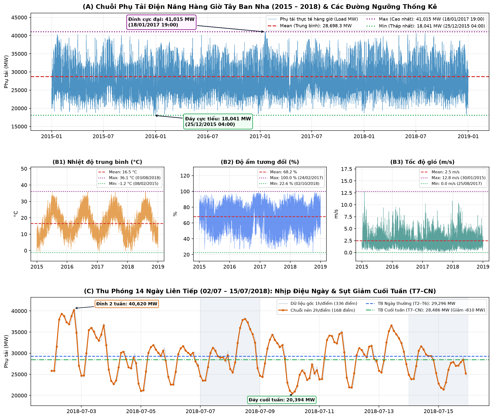
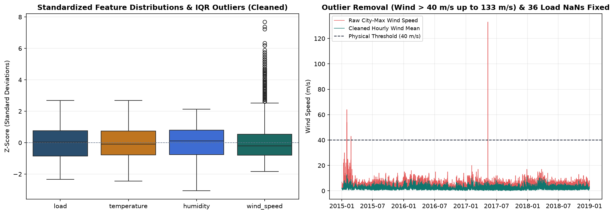
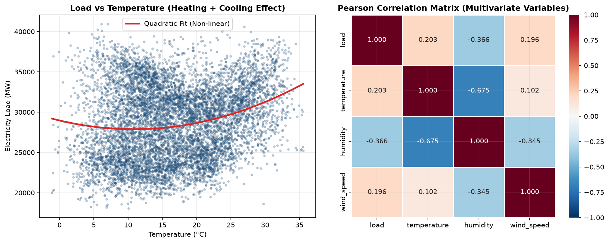
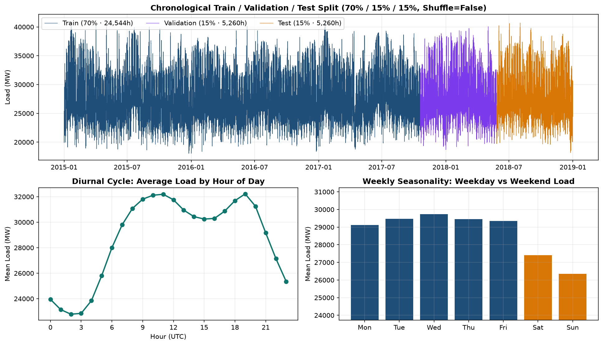
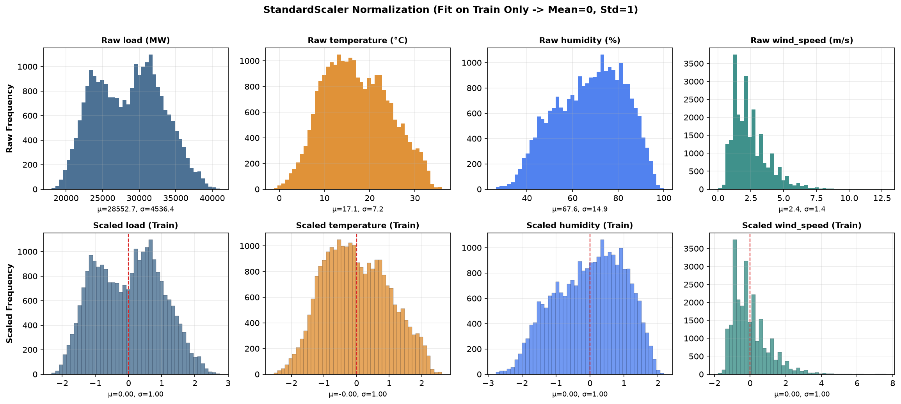
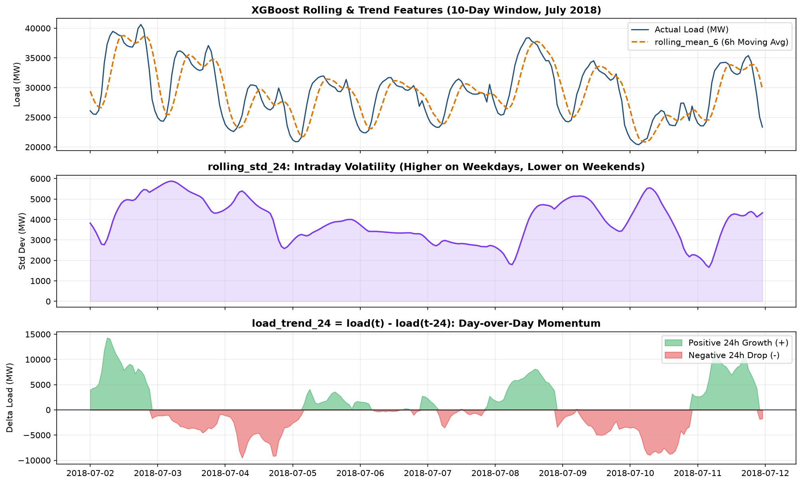

*(Xem chi tiết từng phần tại: [`01_data_understanding_and_preprocessing.md`](01_data_understanding_and_preprocessing.md) & [`02_temporal_split_and_feature_engineering.md`](02_temporal_split_and_feature_engineering.md))*

---

## 3. Kết Quả Ba Nhóm Mô Hình & Bảng Xếp Hạng (Mục 6 – 10)

| Hạng | Mô hình | Bộ đặc trưng | Train RMSE | Val RMSE | Test RMSE (MW) | Test MAE (MW) | MAPE (%) | $R^2$ |
|:---:|---|---|---:|---:|---:|---:|---:|---:|
| **1** | `XGBoost (Load-Only 27f)` | 24 Load Lags + 3 Roll | `233.29` | `484.82` | **`429.79`** | **`274.18`** | **`0.96%`** | **`0.9912`** |
| **2** | `XGBoost (Multivariate 99f)` | 96 Lags + 3 Roll/Trend | `84.20` | `503.56` | **`441.47`** | **`279.88`** | **`0.97%`** | **`0.9908`** |
| **3** | `VAR` ($p = 24$, Level $d = 0$) | 4 Vars × 24 Lags | `765.88` | `793.68` | **`686.27`** | **`482.72`** | **`1.71%`** | **`0.9777`** |
| **4** | `LSTM (64->32->1)` | 3D Tensor `(24, 4)` | `1,257.04` | `1,393.63` | **`1,163.37`** | **`882.67`** | **`3.09%`** | **`0.9358`** |
| **5** | `Persistence Naive (lag_1)` | 1 Lag (`load_lag_1`) | `1,421.51` | `1,506.82` | `1,383.37` | `1,045.66` | `3.69%` | `0.9092` |
| **6** | `Seasonal Naive 24h (lag_24)` | 1 Lag (`load_lag_24`) | `3,513.96` | `3,506.87` | `3,623.04` | `2,533.83` | `8.77%` | `0.3772` |

* **Chẩn đoán `VAR`:** Kiểm định ADF xác nhận cả 4 chuỗi đều dừng ở bậc gốc (`p < 0.001`), nên $d = 0$. `AIC` và `BIC` đều chọn $p = 24$ (tổng cộng `388` tham số trên 4 phương trình).
* **Tuning `XGBoost`:** Lưới $3 \times 2$ (`max_depth` $\in \{4,6,8\}$, `n_estimators` $\in \{500,800\}$) với `Early Stopping (40)` đạt kết quả tốt nhất tại `Depth=8, Trees=800` (`Best Iter = 797`, `Val RMSE = 503.56 MW`).
* **Kiến trúc `LSTM`:** `Input(24,4) -> LSTM(64, return_sequences=True) -> LSTM(32) -> Dense(1)` với Loss `MSE`, Optimizer `Adam`, `batch_size=256`, dừng sớm tại Epoch `8` (`Train RMSE = 1,065.37 MW`, `Best Val RMSE = 1,393.63 MW`).

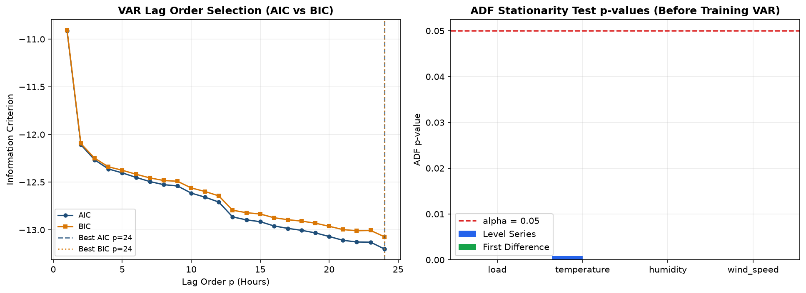
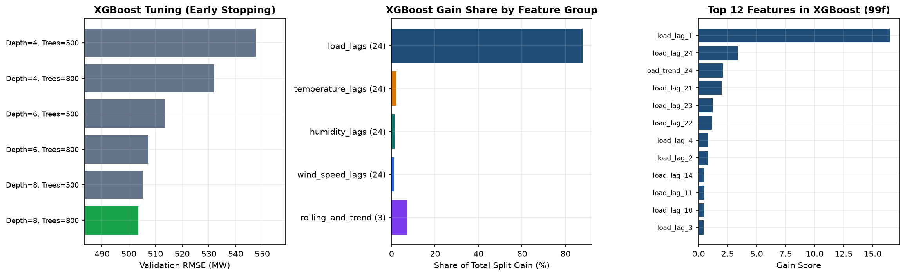
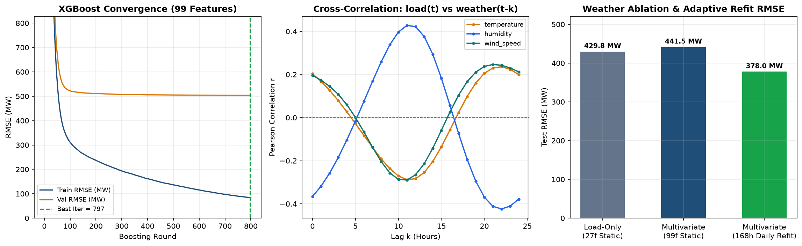
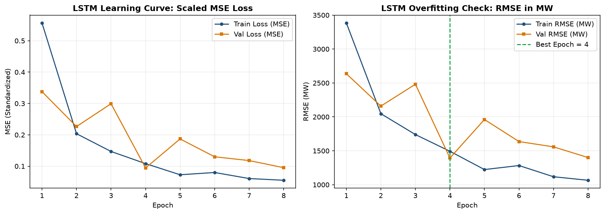
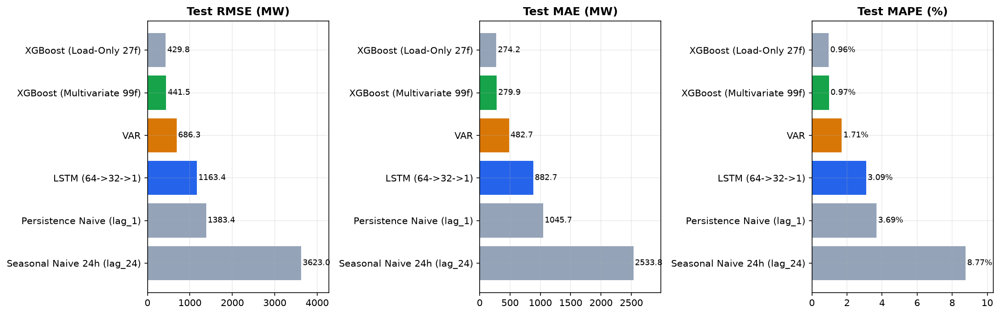
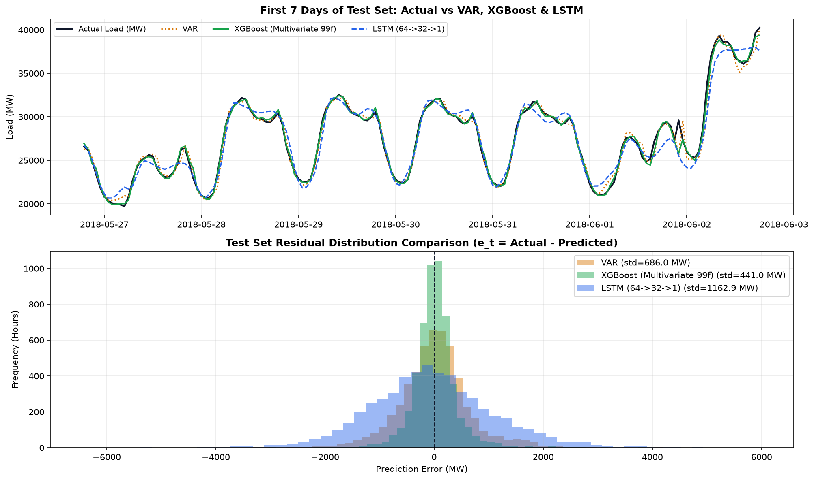
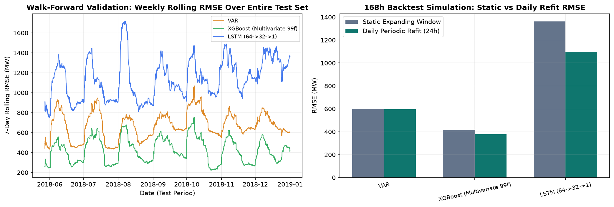
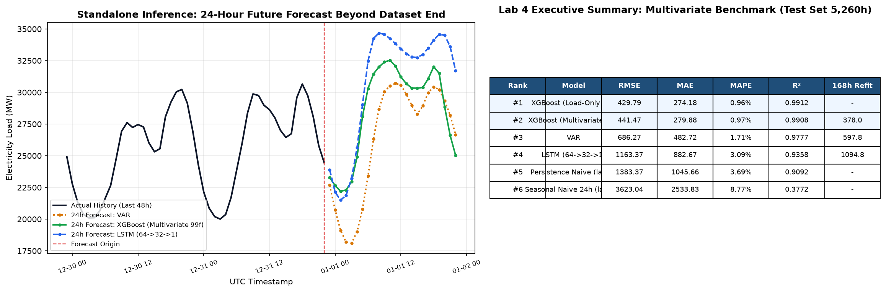

*(Xem chi tiết tại: [`03_var_and_xgboost_modeling.md`](03_var_and_xgboost_modeling.md) & [`04_lstm_and_walk_forward_backtesting.md`](04_lstm_and_walk_forward_backtesting.md))*

---

## 4. Trả Lời 6 Câu Hỏi Phân Tích (Mục 11)

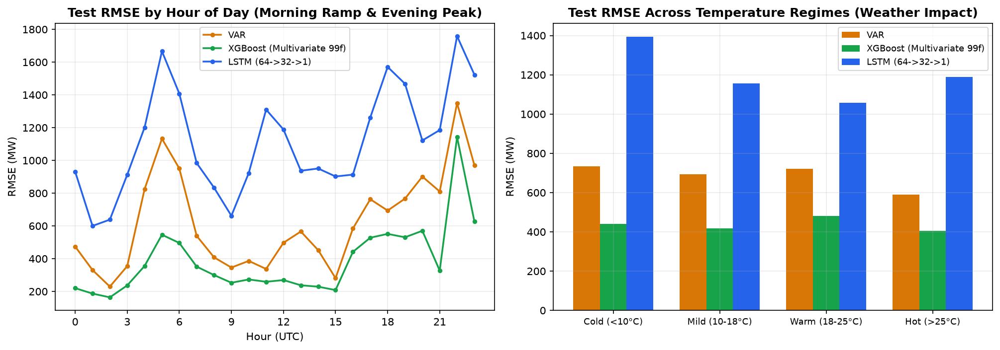

1. **Biến thời tiết nào ảnh hưởng mạnh nhất đến điện năng?**
   - Theo tương quan tuyến tính/hạng: **`humidity`** có độ lớn tương quan cao nhất ($r = -0.3661$, Spearman $\rho = -0.3690$) do độ ẩm dao động ngược chiều với nhiệt độ và phụ tải ban ngày.
   - Theo quan hệ nhân quả và độ lợi phân nhánh: **`temperature`** có kiểm định nhân quả Granger lên `load` mạnh vượt trội ($p = 6.79 \times 10^{-69}$ so với `wind_speed` $3.37 \times 10^{-6}$ và `humidity` $2.20 \times 10^{-5}$) và chiếm tỷ trọng Gain cao nhất trong nhóm thời tiết (`2.27%` vs `humidity` `1.44%`, `wind_speed` `1.07%`).
2. **Khi nào VAR thất bại?**
   - `VAR` kém hơn `XGBoost` tới **`+244.80 MW` RMSE** trên tập Test vì: (a) quan hệ giữa nhiệt độ và phụ tải mang hình **chữ U phi tuyến** (cả trời rất lạnh `< 10°C` và trời nóng `> 25°C` đều tăng phụ tải sưởi/điều hòa), phương trình tuyến tính không nắm bắt được điểm uốn; (b) với `p = 24`, VAR phải ước lượng `388` hệ số đồng thời nên dễ nhiễu ở khung giờ chuyển tải buổi sáng.
3. **XGBoost học được thông tin gì từ thời tiết?**
   - XGBoost tách ngưỡng phi tuyến theo chế độ nhiệt độ (đạt RMSE tốt nhất ở trời nóng `> 25°C` là `405.26 MW`, so với `VAR` `588.88 MW`). Tuy nhiên, thực nghiệm Ablation cho thấy khi đã có đủ 24 lags nội tại của phụ tải + rolling/trend, quán tính phụ tải đã phản ánh gián tiếp diễn biến thời tiết giờ trước — việc đưa tràn lan `72` lags thời tiết (`temperature/humidity/wind_speed_lag_1..24`) làm độ sâu cây tăng mạnh Overfit Gap (`+357.27 MW` vs `+196.51 MW` ở `Load-Only 27f`), khiến Test RMSE nhích nhẹ từ `429.79 MW` lên `441.47 MW`.
4. **LSTM học được chu kỳ nào (ngày, tuần)?**
   - Với cửa sổ đầu vào dài đúng **`L = 24` giờ**, mỗi Tensor `(24, 4)` bao phủ trọn **chu kỳ ngày (24h)**, nhưng **không bao phủ được chu kỳ tuần (`168h`)** nên LSTM không phân biệt trực tiếp được ngày làm việc và cuối tuần từ một mẫu đơn lẻ.
5. **LSTM có bị overfitting không?**
   - **Không bị overfitting:** `Train RMSE = 1,257.04 MW`, `Val RMSE = 1,393.63 MW`, `Test RMSE = 1,163.37 MW` (`Test - Train Gap = -93.67 MW`). Thực tế mô hình đang hơi **underfitting** do dừng sớm ở epoch `8`, batch lớn (`256`) và chuỗi phụ tải biến động mượt trên 24h khiến cây boosting (`XGBoost`) tận dụng tốt hơn đặc trưng `rolling_mean_6`, `rolling_std_24` và `load_trend_24`.
6. **Sự khác biệt giữa Machine Learning (`XGBoost`) và Deep Learning (`LSTM`) trong bài toán này?**
   - `XGBoost` nhận ma trận phẳng (`99` features kèm `rolling/trend` thiết kế thủ công), tận dụng cực tốt ngưỡng phân nhánh rời rạc, train chỉ mất **`11.36s`**, đạt `RMSE = 441.47 MW` (`MAPE = 0.97%`), nhưng đòi hỏi feature engineering thủ công và không tự giữ bộ nhớ dài hạn ngoài cửa sổ `L`.
   - `LSTM` tự học biểu diễn tuần tự trực tiếp từ Tensor 3D `(24, 4)`, tốn **`18.86s`** trên CPU với `8` epochs (`RMSE = 1,163.37 MW`), phù hợp hơn khi chuỗi dài, có cấu trúc tuần tự phức tạp hoặc mở rộng sang bài toán đa biến hàng trăm nút (như Traffic Forecasting). Khi được cập nhật định kỳ hàng ngày (`Daily Refit` trong Walk-forward 168h), sai số của LSTM cải thiện rõ nhất (`1,362.21 MW` $\rightarrow$ `1,094.81 MW`).

---

## 5. Bài Tập Nâng Cao: Traffic Forecasting (`METR-LA` / `PEMS-BAY`, Mục 12)

* **Đặc tả bài toán:** Dữ liệu tốc độ giao thông đo mỗi `5` phút tại `207` trạm cảm biến ($X_t = [speed_1, \dots, speed_{207}] \in \mathbb{R}^{207}$). Từ `12` bước quá khứ (`60` phút), dự báo đồng thời $15$, $30$ và $60$ phút phía trước:
  $$[X_{t-12}, \dots, X_t] \Rightarrow X_{t+3},\ X_{t+6},\ X_{t+12}$$
* **Phân tích mở rộng:**
  - Trên $207$ biến đồng thời, `VAR` không khả thi về tính toán vì số tham số tăng theo $O(N^2 \cdot p) \approx 207^2 \times p$.
  - `XGBoost` phải dựng $207 \times 3 = 621$ mô hình riêng biệt và bỏ lỡ cấu trúc liên kết không gian giữa các nút giao thông kề nhau trên đường cao tốc.
  - Kiến trúc tiêu chuẩn cho bài toán này là **DCRNN (*Diffusion Convolutional Recurrent Neural Network*)**: biểu diễn mạng lưới cảm biến thành đồ thị có hướng $G = (V, E, W)$ với ma trận kề khoảng cách đường bộ, kết hợp **Diffusion Convolution** (nắm bắt lan truyền kẹt xe xuôi & ngược dòng theo không gian) bên trong các cell **GRU/Seq2Seq** (nắm bắt phụ thuộc theo thời gian).

*(Xem phân tích chi tiết cho Mục 11 & Mục 12 tại: [`05_analytical_questions_and_traffic_forecasting.md`](05_analytical_questions_and_traffic_forecasting.md))*
